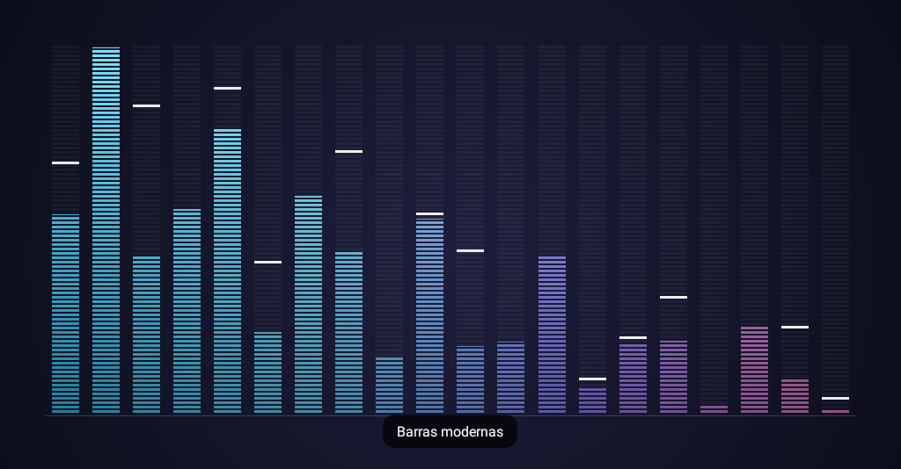
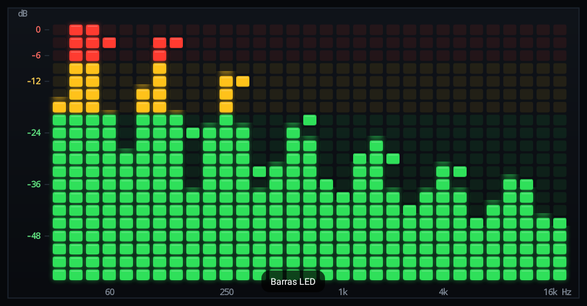
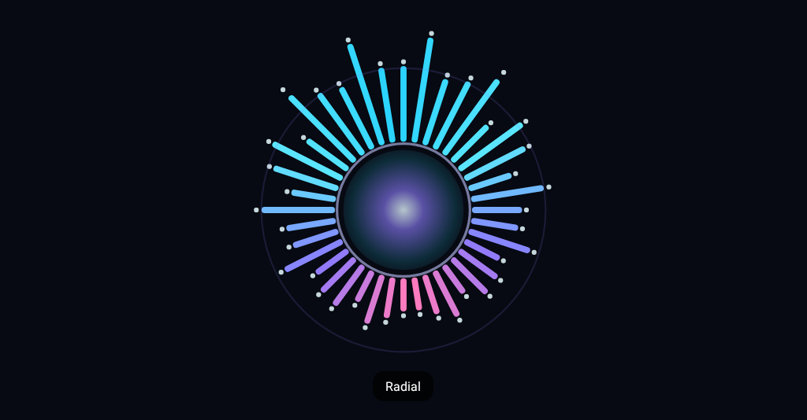
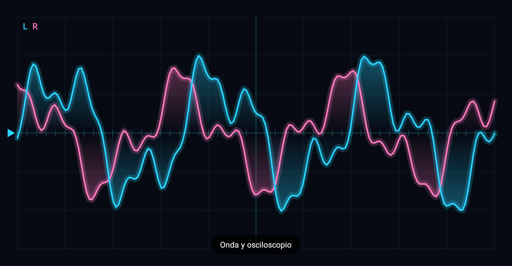
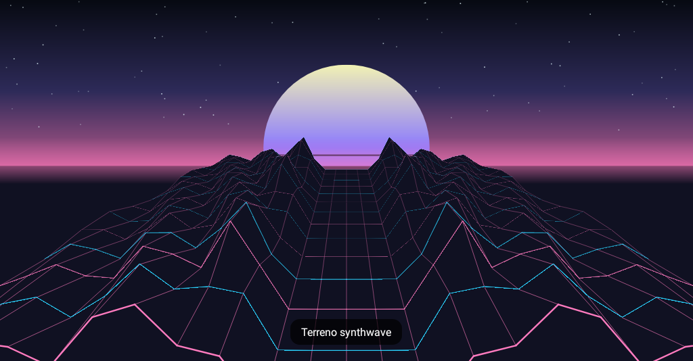
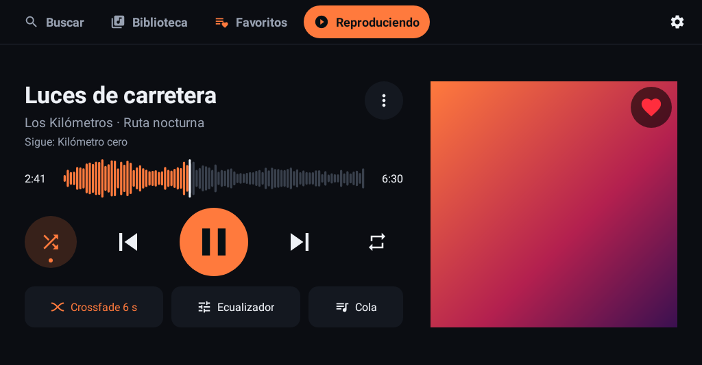
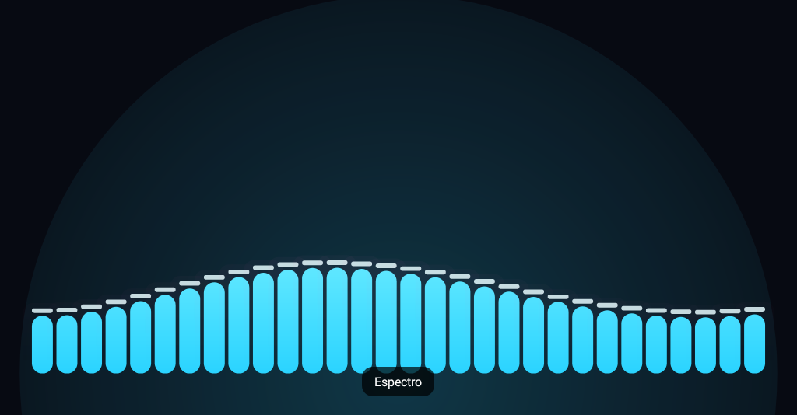

### Novedades de la 0.21.0

**Nueva escena: Barras modernas**

- Es el segundo visualizador, justo después de las Barras LED. Dos toques en la portada pasan de
  una a otra.
- Cada barra se forma con líneas horizontales delgadas, con el color de la paleta de graves a
  agudos, más brillante arriba. Detrás se ve la pista apagada y una línea de pico flota sobre cada
  barra.
- Se mueve igual de natural que las Barras LED y es igual de ligera en el 8227L: 32 barras.

**Barras LED con movimiento natural**

- Suben casi al instante con cada golpe y bajan a velocidad constante, como el medidor de un
  ecualizador de verdad. Antes bajaban de golpe, saltando de LED en LED.
- El LED de arriba se va encendiendo poco a poco, así la columna sube y baja fluida aunque solo
  tenga 9 LED.
- La entrada se suaviza unos 60 ms, para quitar el temblor sin retrasar el ritmo.
- Los 9 LED cubren la parte útil de la escala, así la música recorre toda la columna en vez de
  moverse solo arriba.
- El pico se queda un momento y cae acelerando, como si tuviera peso.

### Novedades de la 0.20.1

**Visualizador más fluido en el autoestéreo (8227L) y Barras LED clásicas**

- **Sin tirones al ajustar la calidad.** La app ajusta sola la calidad del visualizador cada pocos
  segundos, y en la 0.20.0 cada ajuste volvía a pintar imágenes de pantalla completa en el hilo de
  dibujo. Eso daba un tirón cada vez y robaba CPU al análisis del audio, por eso el visualizador
  se atrasaba respecto al ritmo. Ahora esas imágenes se pintan una sola vez por tamaño.
- **Versión ligera fija en equipos modestos** (como el 8227L, que dibuja sin GPU):
  - Radial va sin halo ni resplandores.
  - Onda y osciloscopio va sin relleno ni resplandor.
  - Terreno usa una malla de 14 × 24 con líneas finas.
- **Terreno al ritmo:** toda la malla late con los graves del momento, sin esperar a que las
  montañas lleguen del horizonte.
- **Barras LED clásicas**, como el «SPECTRUM DISPLAY» de un ecualizador Hi-Fi:
  - 10 bandas por octava (31 Hz – 16 kHz) y 9 LED redondos por banda: 3 verdes, 3 ámbar y 3 rojos.
  - Escala de 2 a 18 dB a los dos lados y un pico que se queda encendido un momento.
  - Además es mucho más ligera: como mucho 90 LED pequeños por frame.

### Novedades de la 0.20.0

**Visualizadores: ahora son cuatro, rehechos**

1. **Barras LED** — ecualizador Hi-Fi retro: segmentos verde, ámbar y rojo (3 dB cada uno), el pico
   se queda encendido un momento y cae; escala real en dB y en Hz (30 Hz – 16 kHz). Usa siempre los
   colores clásicos de LED.
2. **Radial** — espectro circular: barras hacia afuera en espejo (graves arriba, agudos abajo), punto
   de pico en cada barra, núcleo que late con el volumen y halo de graves.
3. **Onda y osciloscopio** — retícula de osciloscopio con los canales L y R sobre el mismo eje,
   resplandor y relleno que se desvanece hacia el centro.
4. **Terreno synthwave** — malla 3D en perspectiva que avanza hacia ti; a los lados del camino se
   levantan montañas con la música; cielo con estrellas y sol retro.

Se quitaron Anillos, Partículas, Túnel, Campo de líneas y Ambiente. Si tenías elegida una de ellas,
la app pasa sola a Barras LED. Las paletas (Aurora, Brasa, Océano, Neón, Mono) aplican a Radial,
Onda y Terreno. Dos toques en la portada siguen cambiando de visualizador.

Pensadas para el estéreo: las barras LED copian una columna ya pintada en lugar de dibujar cada
segmento, y el terreno se dibuja con líneas (sin OpenGL). Si el equipo va justo, el gobernador quita
primero resplandores y detalle.

### Novedades de la 0.19.0

**«Reproduciendo» rediseñada**

- **Favorito en la portada:** corazón en la esquina superior derecha. En silueta si la canción no es
  favorita; un toque lo rellena en rojo y la agrega a favoritos, otro toque la quita. La ficha
  «Favorito» de abajo se quitó.
- **Portada y visualizador con toques:**
  - 1 toque: cambia entre portada y visualizador;
  - 2 toques (o deslizar a los lados): cambia de visualizador;
  - 3 toques: visualizador a pantalla completa. Ahí, 1 toque regresa al reproductor y deslizar
    cambia de visualizador.
  Para distinguir uno, dos y tres toques, el efecto de un toque tarda unas tres décimas de segundo.
- **Engrane en el visualizador:** con el visualizador a la vista, el engrane de la esquina superior
  derecha abre sus ajustes. Por eso «Visualizador» ya no está en la barra superior.
- **Progreso como onda de sonido:** la barra de progreso dibuja el volumen de la canción a lo largo
  de toda su duración. Se calcula en segundo plano la primera vez que suena cada canción (se ve una
  barra normal mientras tanto) y se guarda para las siguientes.
- **Un solo color activo:** reproducir, progreso, aleatorio, repetir y crossfade usan el color de la
  portada, igual que la barra superior. Aleatorio y repetir activos llevan además fondo y un punto,
  para que se note con sol en la pantalla.
- **Botones más grandes** (76 px de zona táctil), tiempos a los lados del progreso en letra más
  grande, «Sigue: …» bajo el artista y «⋮» como botón redondo.
- **Favoritos de la barra superior** con icono propio (lista con corazón).
- En el teléfono en vertical, las secciones de la barra inferior caben completas.

(Capturas del autoestéreo, 1024×534. El naranja es un ejemplo: el color cambia con la portada de cada canción.)

### Novedades de la 0.18.0

- **Barra superior con color dinámico:** la sección activa (Biblioteca, Reproduciendo, Visualizador…)
  usa el mismo color que el botón de reproducir, tomado de la portada de la canción que suena. También
  la barra de progreso del mini reproductor. Si el color es muy oscuro (o muy claro en el tema claro) se
  ajusta para que siempre se distinga.
- **Botón «Favoritos» en la barra** (entre Biblioteca y Reproduciendo): reproduce tu lista de
  favoritos desde el principio, respeta el aleatorio y abre «Reproduciendo». Si esa lista ya está
  sonando, solo abre «Reproduciendo»; si aún no tienes favoritos, te avisa.
- **Buscar:** el teclado se esconde solo 1,5 s después de la última letra para dejar ver los
  resultados (tocar el campo lo muestra de nuevo).

### Novedades de la 0.17.0

- **Favoritos y listas a salvo al reinstalar:**
  - cada vez que cambian, se guarda una copia en `Documentos/RadilloPlayerWave/listas-y-favoritos.json`
    (fuera de la app, así que no se borra al desinstalar);
  - al instalar de nuevo se recuperan solos en cuanto la app encuentra la música, aunque el sistema
    haya cambiado los números internos de las canciones;
  - si alguna canción está en una USB que no está puesta, queda pendiente y se agrega sola al
    ponerla;
  - **Ajustes ▸ Biblioteca:** «Exportar favoritos y listas» guarda una copia donde quieras e
    «Importar» la recupera (en Android 11 o más nuevo es la forma de recuperarlos tras reinstalar).
- **Actualizar sin desinstalar:** desde la 0.16.0 todas las versiones van firmadas con la misma
  clave: la nueva se instala encima y conserva todo. Además, la base de datos ya no puede
  borrarse sola en una actualización futura.

### Novedades de la 0.16.1

- **Marquesina en títulos y artistas largos:** si el título de la canción o el artista no caben, el
  texto se desplaza solo, de forma continua, en «Reproduciendo», en el mini reproductor y en el
  visualizador. Los textos cortos se quedan quietos.

### Novedades de la 0.16.0

- **Visualizador sin tirones ni congelones** (sobre todo «Espectro» a pantalla completa en el estéreo):
  - si el equipo no da abasto, la calidad se ajusta en unos 4 segundos (antes podía tardar más de
    40 s de tirones, o no ajustarse nunca);
  - el dibujo ya no acapara la pantalla: los toques y el cambio a pantalla completa responden
    aunque un frame tarde;
  - en equipos modestos, la pantalla completa se dibuja con la mitad de píxeles y el sistema la
    amplía: se ve algo más suave y va fluida;
  - en «Espectro», al bajar la calidad se apaga primero el halo de fondo, que es lo más pesado de
    dibujar (más de la mitad del frame, según las mediciones).
- **Cambiar de visualizador desde «Reproduciendo»:** con el visualizador en el recuadro de la
  carátula, **doble toque** o **deslizar** a los lados cambia de visualizador (aparece su nombre) y
  **un toque** vuelve a la carátula.
