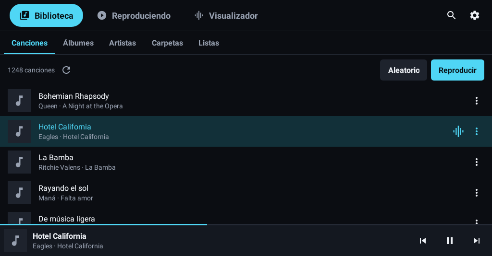
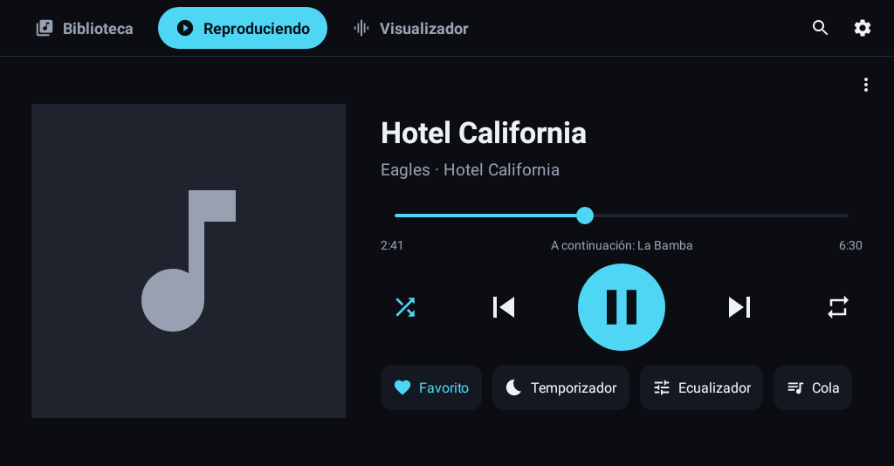
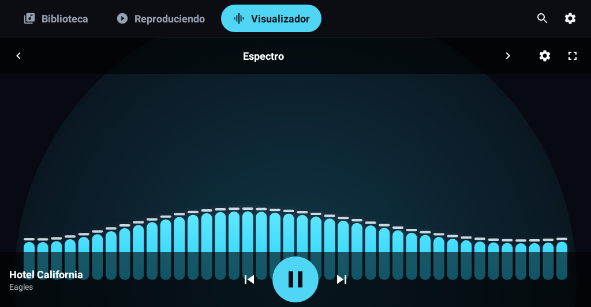
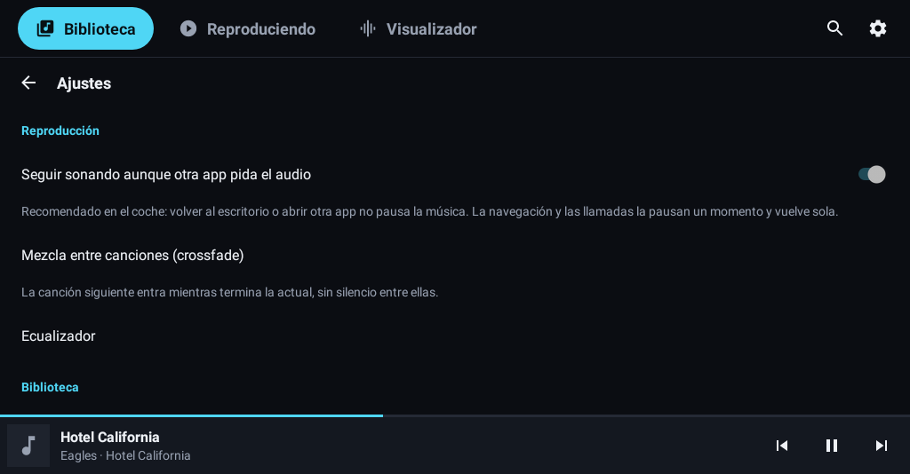

# Dispositivo objetivo: autoestéreo MTK 8227L (1 GB RAM, Mali-450, 1024×600)

Adaptación de RadilloPlayerWave a una unidad Android de coche de gama baja.
Estado: **Opción 1 aprobada por el usuario** (música en memoria interna y USB). Fases A, B y C
hechas, auditoría 0.9.0 hecha; D pendiente.

## 1. Qué es realmente este hardware y qué implica

| Dato | Valor | Consecuencia para la app |
|---|---|---|
| SoC | MediaTek MT8227L / AC8227L, 4× Cortex-A7 a ~1,3 GHz, **32 bits** (armeabi-v7a) | CPU en orden, sin arm64. Nada pesado en el hilo principal; pocas llamadas de dibujo por frame; builds **release con R8** (los debug son 2–4× más lentos). |
| GPU | Mali-450 MP2 (Utgard) | **Solo OpenGL ES 2.0**: la escena de terreno 3D prevista en ES 3.0 debe rehacerse en ES 2.0 o en Canvas. Poca tasa de relleno: nada de capas fuera de pantalla (`saveLayer`), desenfoques, sombras, ni mezclas aditivas a pantalla completa. |
| RAM | 1 GB total; ~250–400 MB libres para la app en primer plano; límite de heap por proceso típico 128–192 MB | Presupuesto: app completa ≤ 90 MB PSS con el visualizador activo; servicio de reproducción solo ≤ 40 MB. Sin `largeHeap` (no ayuda y puede ser ignorado). |
| Android | Declara «12» (antes se pensaba «11»), pero es **8.1 real (API 27)**, confirmado con el informe de Diagnóstico: solo la cadena de versión está alterada en `build.prop` | `Build.VERSION.SDK_INT` **no es fiable**: una API «de 30» puede no existir y lanzar `NoSuchMethodError`. Detectar el nivel real por presencia de clases y no usar nada por encima de API 26 sin guardas. |
| Pantalla | 1024×600 px, 160 dpi (mdpi real), horizontal fija | 1 dp = 1 px: la UI se diseña a tamaño real en una sola disposición horizontal. Objetivos táctiles ≥ 64 dp, texto ≥ 20 sp (uso al volante). Todos los recursos vectoriales; ningún mapa de bits por densidad. |
| Entorno | Coche: arranque con la llave, música en USB/SD, radio y Bluetooth del propio equipo compiten por el foco de audio, teclas multimedia del volante | Escáner de carpetas USB además de MediaStore; reanudación tras el arranque (opcional); foco de audio y `KEYCODE_MEDIA_*` por MediaSession (ya presente); modo oscuro por defecto. |

## 2. Diagnóstico del proyecto actual frente a este objetivo

Lo que ya encaja (se conserva):

- Separación en módulos `core` / `data` / `player` / `visualizer` / `app` y la regla «visualizer nunca depende de player».
- Análisis de audio en Kotlin puro (FFT 2048 a 60 Hz ≈ 7 MFLOPS: trivial incluso para un A7), tap de PCM sin micrófono, `QualityGovernor`.
- Media3 ExoPlayer + `MediaLibraryService`: necesario para el tap de PCM (la alternativa `MediaPlayer` + `audiofx.Visualizer` exigiría el permiso de micrófono, prohibido por el pliego). Se recorta su configuración.
- Room para la caché de biblioteca, favoritos y listas (coste de memoria despreciable; se mantiene «al mínimo»).

Lo que **no** encaja:

| Pieza actual | Problema en este hardware | Sustituto propuesto |
|---|---|---|
| Jetpack Compose + Material 3 | ~4–5 MB de dex y 30–60 MB de RAM extra; primera composición de 0,5–1 s en un A7; recomposiciones en listas | Vistas XML planas (`ConstraintLayout`/`LinearLayout`), `RecyclerView`, ViewBinding, widgets de plataforma con estilo propio |
| Compose Canvas para las escenas (hilo principal) | Un frame lento del visualizador congela también la UI; ~500 llamadas de dibujo por frame en Partículas | `SurfaceView` con hilo de render propio, `android.graphics.Canvas` acelerado (`lockHardwareCanvas`, API 26+, con respaldo software), lotes `drawPoints`/`drawLines` (de ~1 300 llamadas a ~4), tope de 30 fps |
| material-icons-extended | 23 MB del APK debug; miles de vectores | ~30 `VectorDrawable` propios en `res/drawable` |
| Coil | Caché, hilos y decodificación genéricos | Cargador propio: `BitmapFactory` con `inSampleSize` + `RGB_565` (mitad de memoria), `LruCache` ≤ 6 MB, 2 hilos |
| Hilt | Generación de código y arranque extra sin beneficio con ~15 clases | Grafo manual (`AppGraph` con singletons perezosos) |
| Navigation Compose | Dependencia completa para 10 rutas | `FragmentManager` directo, una `Activity` |
| DataStore | Lectura asíncrona que obliga a «esperar» el tema al arrancar | `SharedPreferences` (lectura síncrona de ~10 claves) |
| APK **debug** sin R8 | Es lo que se ha instalado hasta ahora: sin optimizar ni reducir | Build **release** firmado, minificado y con recursos reducidos (previsión: 24 MB → 4–6 MB) |

## 3. Estructura propuesta

```
app/        Activity única (horizontal), fragments: Biblioteca (pestañas), Reproduciendo, Visualizador,
            Listas/Detalle, Búsqueda, Ecualizador, Ajustes, Diagnóstico. XML + ViewBinding.
            AppGraph (DI manual), cargador de carátulas, iconos vectoriales propios.
core/       Modelos, DeviceProfile (RAM, nivel de API real, perfil «gama baja»), utilidades.
            Colores/dimensiones/estilos en XML. Sin Compose.
data/       MediaStore + escáner de carpetas (USB/SD) con MediaMetadataRetriever, Room mínimo
            (sin paging/rx; un solo hilo de consulta), preferencias (SharedPreferences).
player/     ExoPlayer solo audio (LoadControl de 2 MB, sin renderers de vídeo/texto),
            MediaLibraryService, tap PCM, efectos, temporizador. Sin cambios de arquitectura.
visualizer/ analysis (igual), engine (igual + tope de fps), QualityGovernor (igual),
            scenes sobre android.graphics.Canvas, VisualizerSurfaceView (hilo de render).
```

Dependencias finales: `media3-exoplayer`, `media3-session`, `room-runtime`/`room-ktx` + compilador (KSP),
`kotlinx-coroutines-android`, `core-ktx`, `fragment-ktx`, `recyclerview`, `constraintlayout`,
`palette` (opcional, 50 KB). Pruebas: JUnit, Truth, Robolectric. **Sin** Compose, Material, Hilt,
Coil, Navigation ni DataStore. La app no tiene código nativo: un solo APK universal.

## 4. Configuración de compilación recomendada

`app/build.gradle.kts` (fragmentos relevantes; AGP 9.4, Kotlin integrado):

```kotlin
android {
    namespace = "com.radillo.playerwave"
    compileSdk = 37

    defaultConfig {
        applicationId = "com.radillo.playerwave"
        minSdk = 24            // no subir: la ROM puede ser más antigua de lo que declara
        targetSdk = 37
        versionCode = 6
        versionName = "0.6.0-coche"
    }

    // Solo los idiomas de la app: elimina las traducciones de las bibliotecas AndroidX.
    androidResources {
        localeFilters += listOf("es", "en")
    }

    signingConfigs {
        create("release") {
            // Claves en secretos de GitHub Actions (y copia de respaldo en manos del usuario).
            val path = System.getenv("RADILLO_KEYSTORE_PATH")
            if (path != null) {
                storeFile = file(path)
                storePassword = System.getenv("RADILLO_KEYSTORE_PASSWORD")
                keyAlias = System.getenv("RADILLO_KEY_ALIAS")
                keyPassword = System.getenv("RADILLO_KEY_PASSWORD")
            }
        }
    }

    buildTypes {
        release {
            isMinifyEnabled = true          // R8 (modo completo por defecto en AGP 8+)
            isShrinkResources = true        // elimina recursos sin referencia
            isDebuggable = false
            proguardFiles(getDefaultProguardFile("proguard-android-optimize.txt"), "proguard-rules.pro")
            signingConfig = signingConfigs.getByName("release")
        }
        debug {
            applicationIdSuffix = ".debug"
            versionNameSuffix = "-debug"
            isMinifyEnabled = false
        }
    }

    buildFeatures {
        viewBinding = true
        buildConfig = true
        // compose = false (eliminado)
    }

    packaging {
        resources.excludes += setOf(
            "META-INF/*.version", "META-INF/*.kotlin_module", "kotlin/**",
            "DebugProbesKt.bin", "META-INF/LICENSE*", "META-INF/AL2.0", "META-INF/LGPL2.1",
        )
    }

    compileOptions {
        sourceCompatibility = JavaVersion.VERSION_17
        targetCompatibility = JavaVersion.VERSION_17
    }
}
```

`app/proguard-rules.pro`:

```
# Más agresivo: permite a R8 cambiar visibilidades y aplanar paquetes.
-allowaccessmodification
-repackageclasses ''

# Fuera los logs de depuración en release (el A7 agradece cada llamada menos).
-assumenosideeffects class android.util.Log {
    public static int v(...);
    public static int d(...);
    public static int i(...);
}

# Media3, Room (KSP) y coroutines traen sus propias reglas de consumidor. Nada más que mantener:
# la Activity y el Service los conserva el manifiesto.
```

`gradle.properties` (además de lo existente):

```
android.enableR8.fullMode=true
android.nonTransitiveRClass=true
android.nonFinalResIds=true
```

Notas:

- Perfiles de referencia (*baseline profiles*) no se incluyen: aportan poco en Android ≤ 9 y
  requieren medir en el propio dispositivo.
- APK universal (`assembleRelease`), no AAB: se instala a mano en la unidad.
- La firma la hace CI con un almacén de claves generado una sola vez; el usuario guarda el `.jks`
  y las contraseñas. Sin firma estable no se podría actualizar la app sin desinstalarla.

## 5. Buenas prácticas para este hardware (reglas que aplicará todo el código)

**Hilos**

- Hilo principal: solo entrada y actualización de vistas. Nada de E/S, decodificación ni consultas.
- Escaneo y base de datos en `Dispatchers.IO.limitedParallelism(2)` (4 núcleos lentos: más hilos solo compiten).
- Análisis de audio en un hilo propio (`THREAD_PRIORITY_DEFAULT`); render del visualizador en su hilo (`THREAD_PRIORITY_DISPLAY`); escaneo en `THREAD_PRIORITY_BACKGROUND`.
- `DiffUtil` en segundo plano (`AsyncListDiffer` con un ejecutor de un hilo).

**Memoria**

- Carátulas: decodificar con `inJustDecodeBounds` + `inSampleSize` a ≤ 256 px (160 px en listas), `RGB_565`, `LruCache` ≤ 6 MB; cancelar cargas al reciclar la fila.
- ExoPlayer: `DefaultLoadControl` con objetivo de 2 MB y 10–30 s de búfer (archivos locales), sin *back buffer*; sin renderers de vídeo, texto ni metadatos; `EXTENSION_RENDERER_MODE_OFF`.
- `onTrimMemory`: vaciar la caché de carátulas y liberar los búferes de las escenas cuando la UI no está visible.
- Sin `largeHeap`. Sin bibliotecas de depuración de memoria en release. Medición con la pantalla de **Diagnóstico** de la propia app (RAM total/libre, PSS del proceso, heap máximo, nivel de API real, GPU, fps y calidad del visualizador) y con `adb shell dumpsys meminfo` cuando haya PC.

**GPU / UI**

- Disposiciones planas (≤ 2 niveles), sin fondo de ventana redundante (el raíz pinta el fondo una sola vez), sin elevación/sombras, sin `alpha` animado en vistas grandes, sin recorte de esquinas en listas.
- Iconos `VectorDrawable` ≤ 48 dp; ninguna imagen por densidad; texto del sistema.
- Un solo modo oscuro por defecto (confort nocturno al volante), claro opcional. Colores planos de alto contraste.
- Transiciones: ninguna animación de pantalla; cambio de escena por fundido a fondo (sin `saveLayer`).

**Visualizador**

- `SurfaceView` + hilo de render con `Choreographer`; tope de **30 fps** por defecto en este perfil (60 opcional). Menos calor y mitad de CPU/GPU.
- Lotes: partículas y segmentos con `drawPoints`/`drawLines` por color (4–8 llamadas por frame en vez de cientos); degradados y `Paint` creados en `rebuild`, nunca por frame.
- Perfil «gama baja» (`DeviceProfile`): densidad base 0,6, calidad mínima 0,25, máximo 150 partículas, Ambiente con 3 manchas pequeñas y mezcla aditiva limitada a su radio.
- Fundido entre escenas por alfa del fondo, sin capas fuera de pantalla.

**Android «falso»**

- `RealApiLevel`: detectar el nivel real por presencia de clases (`android.app.Person` → 28, `android.app.role.RoleManager` → 29, `android.media.MediaParser` → 30, `android.window.SplashScreen` → 31…) y mostrarlo en Diagnóstico junto al declarado.
- Toda API > 26 detrás de una guarda del nivel **real** y `try/catch (LinkageError)`. Nada de reflexión sobre APIs ocultas.
- Permisos: `READ_EXTERNAL_STORAGE` (≤ 32) / `READ_MEDIA_AUDIO` (≥ 33) según el nivel real; `requestLegacyExternalStorage` para un Android 10 real.

**Coche**

- Escáner de carpetas para USB/SD (`/storage/XXXX-XXXX`) con `MediaMetadataRetriever` y caché en Room, además de MediaStore; rescan al recibir `ACTION_MEDIA_MOUNTED`.
- Pantalla horizontal fija (`screenOrientation="landscape"`) en este perfil; teclado de búsqueda con `adjustResize` (ocupa media pantalla de 600 px).
- Reanudar la reproducción al encender (opcional, `RECEIVE_BOOT_COMPLETED`) y recordar posición y cola.
- Foco de audio cedido a radio/BT del equipo y recuperado al volver (`handleAudioFocus = true`, ya presente).

## 6. Plan por fases (cada una termina con un APK release probado en CI)

| Fase | Contenido | Probar en la unidad |
|---|---|---|
| **A. Cimientos** | Build release firmado y reducido; `DeviceProfile` + nivel de API real; pantalla Diagnóstico; tope de fps y valores por defecto de gama baja en el visualizador actual; LoadControl y renderers solo audio; iconos propios en lugar de icons-extended | Arranque, RAM en Diagnóstico, fps de cada escena. Sirve de **línea base** antes de reescribir la UI |
| **B. Visualizador en SurfaceView** | Escenas portadas a `android.graphics.Canvas` con lotes; hilo de render; `visualizer` y `core` sin Compose | Fluidez a 30/60 fps, calor, calidad del gobernador |
| **C. UI en Vistas** | Todas las pantallas en XML/RecyclerView para 1024×600; cargador de carátulas propio; fuera Compose, Hilt, Coil, Navigation, DataStore | Respuesta táctil, memoria total, tamaño del APK |
| **D. Coche** | Escáner USB/SD, montaje/desmontaje, reanudación al arrancar, teclas del volante, ajuste fino con Diagnóstico | Uso real conduciendo (de copiloto) |

La antigua Fase 5 (terreno 3D en OpenGL ES 3.0) pasa a opcional en ES 2.0 o Canvas, al final.

## 7. Decisión y estado

El usuario eligió la **Opción 1** (Vistas nativas, fases A–D). La música del coche está en la
memoria interna del equipo y en memorias USB: el escáner de carpetas de la Fase D prioriza
los volúmenes USB.

### Fase A (hecha, 0.6.0-faseA)

- Build **release** con R8 modo completo, recursos reducidos, `localeFilters` es/en y exclusión
  de metadatos; firma con clave propia cifrada en el repositorio (`keystore/radillo-release.jks.enc`,
  secreto `RADILLO_KEYSTORE_PASSWORD`) y respaldo con la clave de depuración. CI publica
  `RadilloPlayerWave.apk` en Releases e indica la firma usada.
- `core.device.RealApiLevel` (nivel de API real por presencia de clases), `DeviceProfile`
  (RAM, heap, 32/64 bits, pistas de hardware, acelerómetro, modo coche → `lowEnd`,
  `fixedLandscape`, `defaultMaxFps`, `visualizerDensityScale`, `minQuality`, `artworkMaxPx`) y
  `GpuProbe` (cadenas de OpenGL ES vía EGL).
- Visualizador: tope de fps (`VisualizerEngine.setMaxFps`, 30 por defecto en gama baja, ajuste
  «Fotogramas por segundo» Automático/30/60), `SceneParams.deviceScale` (0,6 en gama baja),
  calidad mínima del gobernador según perfil, medición de fps (`engine.fps`). El gobernador
  conoce el tope (`targetFrameSeconds`) para no confundir frames limitados con tardíos.
- Reproductor: `DefaultLoadControl` de 2 MB (10–30 s) sin *back buffer*; fábrica de renderers
  **solo audio** (sin vídeo, texto, metadatos, cámara ni imagen) con *decoder fallback*.
- Pantalla **Diagnóstico** (Ajustes ▸ Dispositivo): modelo, hardware, ABIs, Android declarado y
  real, perfil y motivos, RAM total/libre, PSS y heap de la app, pantalla, GPU, fps y calidad;
  botón para copiar el informe al portapapeles.
- Orientación: horizontal fija cuando el perfil lo indica (sin acelerómetro o modo coche), con
  ajuste manual «Pantalla siempre horizontal».
- Pruebas nuevas: `DeviceProfileTest` (4) y dos más del gobernador (tope de fps, calidad mínima).

Los iconos propios en lugar de `material-icons-extended` pasan a la Fase C: R8 ya elimina los no
usados en release y la UI Compose actual desaparece en esa fase.

### Fase B (hecha, 0.7.0-faseB)

- El módulo `visualizer` ya no usa Compose: paletas en ARGB (`Argb` con `withAlpha`/`lerp`),
  `Scene.draw(android.graphics.Canvas)`, `CanvasScene` con `Paint`/`Shader` creados en
  `rebuild` y nunca por frame.
- Las siete escenas portadas a `android.graphics`. Lotes: estelas de partículas (un `drawLines`
  por color), raíles del túnel (uno por anillo) y campo de líneas (uno por columna: de ~1 300
  llamadas por frame a 26–56). Ambiente mantiene la mezcla aditiva (`PorterDuff.ADD`) limitada al
  radio de cada mancha.
- `VisualizerEngine`: un cerrojo protege el estado de escenas (configuración desde el hilo
  principal, render desde su hilo); `render(canvas, now)` avanza y dibuja; el fundido entre
  escenas es «a través del fondo» (un rectángulo translúcido, sin `saveLayer`).
- `VisualizerSurfaceView`: `SurfaceView` con hilo de render propio (`THREAD_PRIORITY_DISPLAY`),
  `lockHardwareCanvas` cuando el Android real es ≥ 8.0 y respaldo por software si falla, espaciado
  de frames según el tope de fps, análisis encendido/apagado con la superficie. La UI Compose
  actual lo envuelve con `AndroidView` hasta la Fase C.
- Pruebas: `ScenesUpdateTest` ejercita también `draw()` de todas las escenas con el lienzo stub,
  incluido el tamaño 1024×600.

`core` conserva Compose hasta la Fase C porque la UI actual depende de su tema y componentes.

### Fase C (hecha, 0.8.0-faseC)

- Interfaz en vistas nativas: `MainActivity` (`FragmentActivity`, tema de plataforma sin AppCompat)
  con fragments XML + ViewBinding para biblioteca, detalle de colección/lista, búsqueda,
  reproduciendo, cola, visualizador, ecualizador, ajustes y diagnóstico. Navegación propia
  (`Navigator`): raíl lateral en pantallas ≥ 600 dp (el autoestéreo) y barra inferior en móviles.
- Listas con una sola `RecyclerView`/`RowAdapter` (`ListAdapter`, diff en segundo plano, sin
  animaciones de elementos). Menús y diálogos de plataforma (`AlertDialog`, `PopupMenu`).
- Dimensiones en `values-sw600dp` para 1024×600 a 160 dpi: filas de 76 dp, botones de 64 dp,
  texto de 20 sp. Tema oscuro por defecto en pantallas de coche («según el sistema»).
- Fuera del APK: Compose, Material 3, material-icons-extended, Coil, Navigation y DataStore.
  `core.ui.ArtworkLoader` (RGB_565, `inSampleSize`, LRU ≤ 6 MB, 2 hilos de baja prioridad)
  sustituye a Coil; los ajustes usan `SharedPreferences` (lectura síncrona del tema antes del
  primer frame). Iconos vectoriales propios derivados de Material Icons (Apache 2.0).
- Resultado en CI: **APK release de 1,4 MB** (2,6 MB en la Fase B, 24 MB el debug inicial).
- Prueba nueva: `ResourcesInflationTest` (Robolectric) infla todos los layouts y carga todos los
  iconos con el tema real en móvil y en 1024×600 mdpi, en claro y oscuro.
- Hilt se mantiene: tras R8 su coste es pequeño; se reevaluará con mediciones del equipo real.


### Correcciones 0.8.1–0.8.2 (confirmadas por el usuario en el equipo real, 16-10-2026)

- Visualizador en blanco desde la Fase B: el hilo de render consultaba `MediaController` (solo
  admite el hilo principal). Ahora el controlador publica una instantánea del reloj y el motor
  sigue dibujando aunque el reloj falle (prueba de regresión `VisualizerEngineRenderTest`).
- Menú lateral con icono y texto centrados; iconos de 36 dp en el raíl y de 32 dp en los botones
  (44 dp en reproducir) para usarlos al volante.
- «Reproduciendo» muestra el visualizador en vivo en el recuadro de la carátula (un toque alterna).
- Verificado en el autoestéreo JCAC10003 / alps 8227L a 1024×600: interfaz, menú y visualizadores.

### Informe de Diagnóstico del equipo real (0.10.1, 17-10-2026)

| Dato | Valor medido |
|---|---|
| Equipo | `alps 8227L_demo`, hardware `ac8227l`, ABIs `armeabi-v7a`/`armeabi` (32 bits) |
| Android | Dice «12», pero el nivel de API es **27 (Android 8.1)**; la detección por clases lo confirma. Solo está maquillado el nombre de la versión. |
| Memoria | 1024 MB en total, ~390 MB libres; la app usa **62 MB** (PSS) con el visualizador, heap 28/128 MB |
| Pantalla | 1024×600, 160 dpi, 60 Hz, horizontal fija |
| GPU | Mali-450 MP, OpenGL ES 2.0 |
| Visualizador | 26 de 30 fps con el gobernador al 75 % de detalle, dibujando con **CPU** (automático: gama baja y API < 29) |
| Estabilidad | Ningún cierre inesperado registrado; cambiar el modo de dibujo GPU/CPU/automático no dio problemas |
| Persistencia | Al reiniciar se restauró una cola de **3062 canciones**; sin reescaneo de la biblioteca al abrir |

Conclusiones: el presupuesto de memoria (≤ 90 MB) se cumple con holgura; la elección de CPU para el
visualizador en Android 8.1 es la correcta. Restaurar una cola tan grande bloqueaba el hilo
principal ~2 s al arrancar: desde la 0.10.2 se lee en segundo plano.

### 0.12.x: crossfade y rediseño para 1024×534 (18-10-2026)

- La barra del sistema del estéreo ocupa ~66 px: el espacio útil es **1024×534**, no 1024×600. Por
  eso Android calcula un ancho mínimo de 534 dp y no aplicaba los recursos `sw600dp` (carátula de
  280 en vez de 380, botones de móvil). El diseño ancho fija ahora sus medidas por ancho
  (`values-w600dp`), y las capturas de CI se generan a 1024×534.
- Propuesta 1 elegida por el usuario entre 10: sin raíl lateral; secciones como botones grandes en
  una barra superior con Buscar y Ajustes; en «Reproduciendo», carátula de 360 dp, transporte a lo
  ancho y acciones secundarias en tarjetas.
- Crossfade de 2 a 12 s en Ajustes ▸ Reproducción (`CrossfadeController`).

### 0.11.0: integración con el estéreo Jancar (17-10-2026)

Análisis estático de las apps de fábrica del equipo (servicio `com.jancar.services`, música,
lanzador y aprendizaje de teclas). Lo que importa para la app:

- El servicio de medios del sistema está **exportado y sin permiso**: cualquier app puede
  registrarse como fuente de audio (`IMedia.open(tipo, callback, paquete)`), sin el SDK del
  fabricante. La app usa su propio cliente binder ([`JancarMediaClient`](../player/src/main/kotlin/com/radillo/playerwave/player/jancar/JancarMediaClient.kt)).
- Registrada como fuente **de terceros (20)**:
  - las teclas del volante y del panel llegan directamente (este modelo no envía teclas
    multimedia estándar de Android);
  - llamadas, voz o pantalla apagada la pausan y la reanudan (`suspend`/`resume`); el navegador
    la atenúa (`setVolume`);
  - **al apagar el auto** (6 s después de quitar la llave) el sistema detiene la fuente y fuerza el
    cierre de las apps que no son suyas; a una fuente registrada, en cambio, le pide salir
    (`quitApp(0)`), así que la app sigue viva y **al encender continúa** (`resume`);
  - queda como **app de memoria**: al arrancar el estéreo, el lanzador pide abrir la última fuente
    y el sistema abre la app con `boot_memory=true`; si la música sonaba, sigue.
- **Foco de audio**: al registrarse, el servicio pide el foco en nombre de la app. Mientras el
  puente está conectado la app no lo pide (si lo hiciera, el servicio entendería que otra app se
  quedó el audio y la detendría). Si el servicio no responde, la app vuelve a su foco de coche.
- No se usa el tipo MÚSICA (0) aunque el lanzador solo pinte la carátula de ese tipo: si la app
  de fábrica se abriera con el mismo tipo, el servicio cambiaría de dueño sin avisar y sonarían
  las dos. El widget de música del lanzador abre siempre la app de fábrica (está fijo).
- Avisos abiertos a todas las apps: cámara de reversa (`android.backcar.action.STARTED`/`FINISH`,
  pausa el dibujo del visualizador), llave (`com.jancar.services.action.acc`, extra booleano
  `acc`) y teclas (`com.jancar.services.action.key.event`); se cuentan en Diagnóstico.

Pendiente de confirmar en el auto con el informe de Diagnóstico (líneas «Estéreo» y «Señales del
auto»).

### 0.9.0: auditoría y rediseño (17-10-2026)

Cierres al cambiar de superficie del visualizador, foco de audio de coche, persistencia de la
cola y de la navegación, escaneo incremental con huella y rediseño de la interfaz. Todo en
[`AUDITORIA.md`](AUDITORIA.md).

## 8. Galería

Capturas generadas por CI (`ScreenshotTest`) a 1024×534 (espacio útil real) y 160 dpi con el tema oscuro. Se pueden
añadir fotos del equipo real en `docs/screenshots/`.








